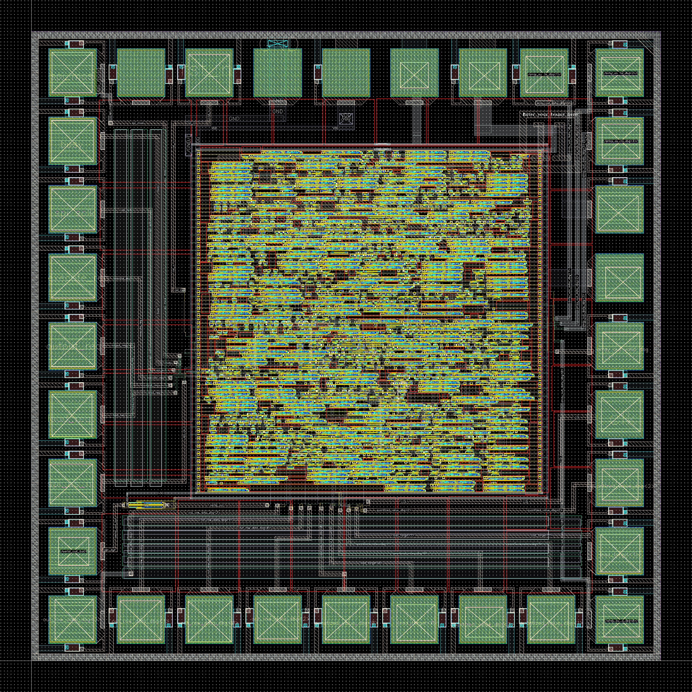

# Neural Network Accelerator

A 4×4 weight-stationary **binary systolic-array accelerator** for neural-network inference, taken from Verilog RTL through a full ASIC flow to a DRC/LVS-clean top-level layout in **TSMC 180 nm**.

Final project for **ESE 5730 – Chip Design**, University of Pennsylvania, Spring 2026.
Team 11: **Kai Segimoto**, **Shang Wang**.

## What the chip does

An external controller loads an input-activation matrix, a weight matrix and a 4-bit signed bias matrix over an SPI-style interface. The chip computes the matrix product in a systolic array, adds the bias, thresholds each result to one bit, and shifts the binary output matrix out serially.

| Block | Module | Role |
|---|---|---|
| Top level | `nn_accelerator_top` | Register files for inputs, weights, biases and outputs; load / execute / output sequencing; bias add and threshold |
| Mode control | `nn_control_fsm` | IDLE → LOAD / EXECUTE / OUTPUT handshake (`load_req`, `execute_req`, `output_req`, `busy`) |
| Serial in | `spi_nibble_slave` | Samples `spi_sclk` / `spi_cs_n` / `spi_mosi` in the system clock domain and assembles 4-bit nibbles |
| Compute | `systolic_array_ws_4x4` | 4×4 grid of PEs; activations flow right, partial sums flow down, column results read from the bottom row |
| Processing element | `systolic_pe_ws` | Holds a 1-bit stationary weight; bipolar 1-bit multiply with an XNOR (equal bits → +1, different → −1) and a 4-bit signed accumulator |
| Serial out | `serial_nibble_tx` | Shifts each 4-bit output row out MSB-first on `serial_out` |

Replacing multipliers with XNOR-based ±1 products and shrinking the accumulators made the array small enough to fit the course area budget.

## Implementation flow

1. **RTL and verification**: Verilog, simulated in ModelSim
2. **Standard-cell library**: cells characterized with Cadence Liberate (`.lib`); LEF abstracts generated with Cadence Abstract
3. **Synthesis**: Cadence Genus → gate-level netlist and constraints
4. **Place and route**: Cadence Innovus (floorplan, placement, power rails, CTS, routing, post-route optimization)
5. **Physical verification**: DEF imported into Virtuoso; DRC, antenna DRC and LVS cleaned at core and top level; core connected to the padframe on upper metal

## Results

- The Genus netlist and the Innovus netlist were both re-simulated in ModelSim against the RTL test case. Expected output rows `1001, 0011, 0110, 1101` matched.
- Genus power report: about **0.336 mW**.
- The top cell passes DRC, antenna DRC and LVS and was finalized for tapeout.
- Final-stage fixes:
  - corrected standard-cell LEF boundaries so they include the implant layers
  - traded debug pads for extra VDD/VSS pads
  - added antenna protection diodes near the pad connections

## Repository layout

| Path | Contents |
|---|---|
| `rtl/` | Final RTL (1-bit systolic design) |
| `early-rtl/` | Earlier 8-bit version from Design Review 1 (SRAM-backed storage, 24-bit accumulators, ReLU + 8-bit quantization, byte-wide serial I/O) with unit and system-integration testbenches |
| `docs/proposal/` | Project proposal slides |
| `docs/design-reviews/` | Design Review 1, Design Review 2 and Critical Design Review reports |
| `docs/Team11_final_pre.pptx` | Final presentation |
| `diagrams/` | draw.io block diagrams (chip flowchart, systolic array, dot-product simulation) |
| `images/` | Top-level layout screenshot |

The `.docx` / `.pptx` reports hold the schematics, layout views, simulation waveforms and DRC/LVS results. Download a file to view it, since GitHub does not render Office documents.

