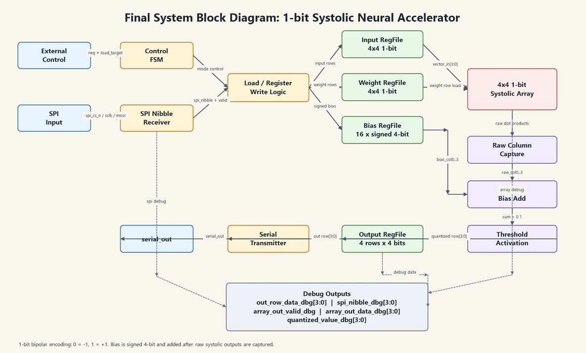
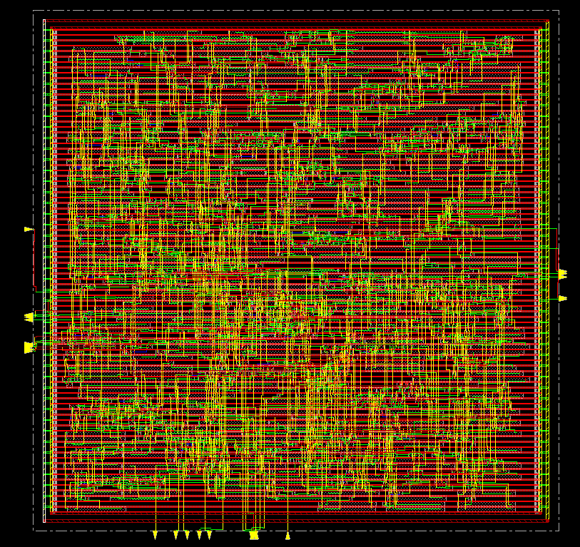
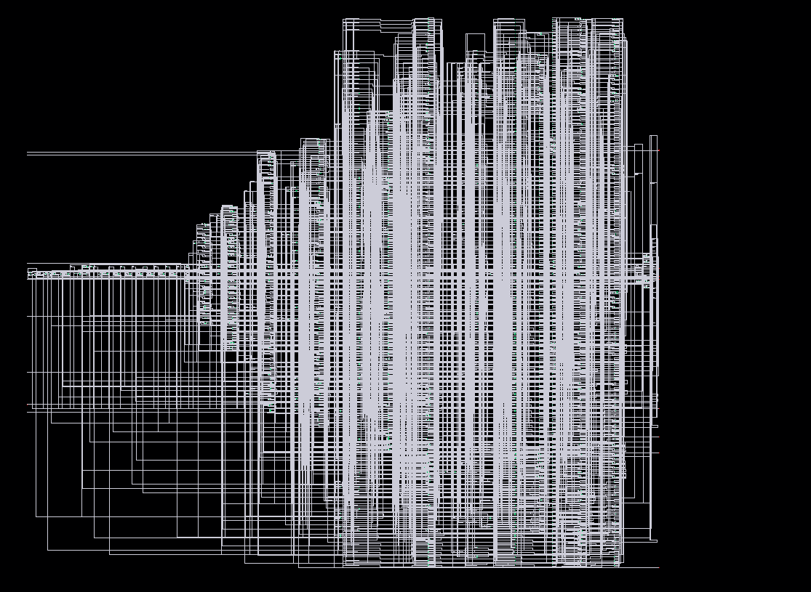
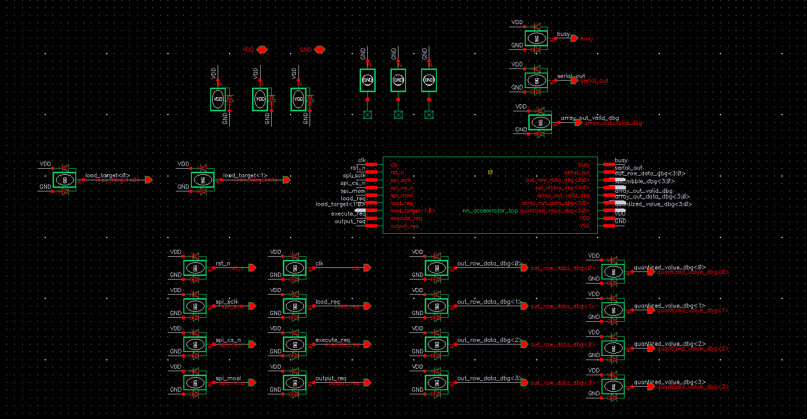
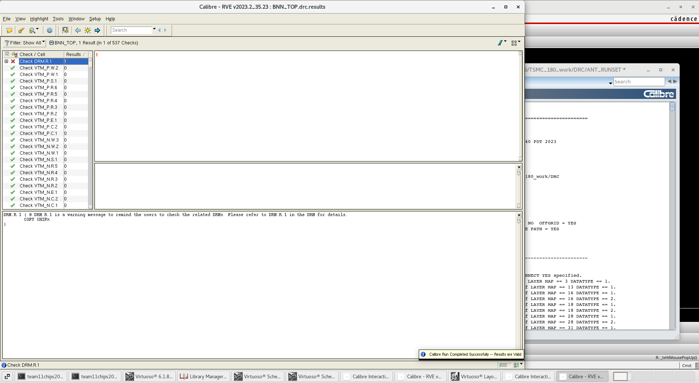
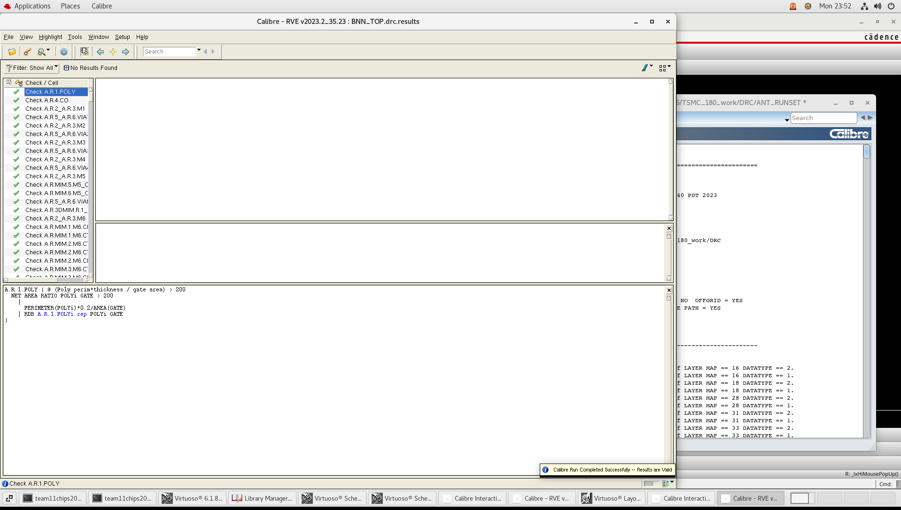
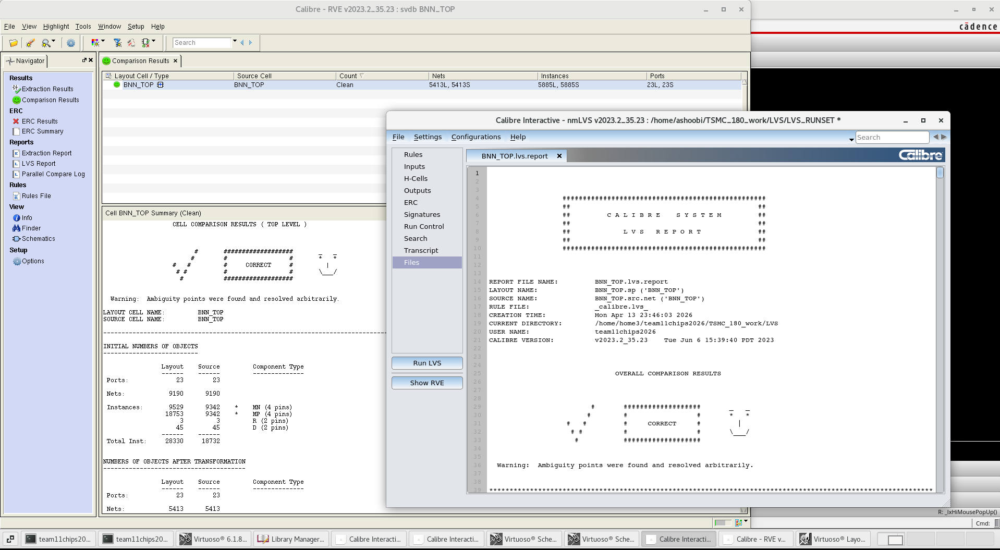
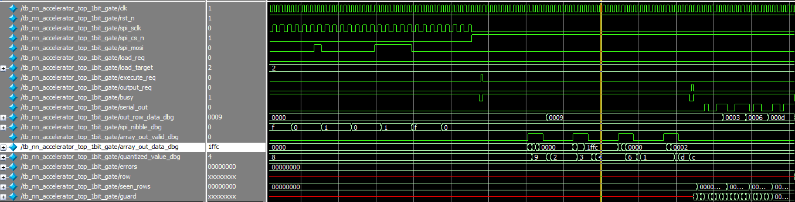
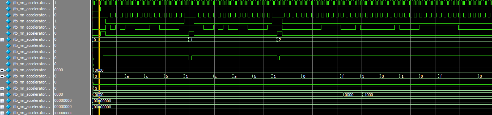
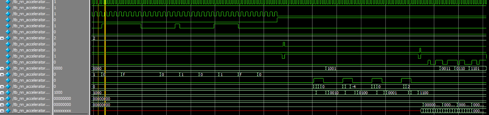

# Critical Design Review

ESE 5730 Chip Design · Team 11: Kai Segimoto, Shang Wang · TA: Bryce Yu

> Markdown version of [`ESE573 Critical Design Review.docx`](ESE573%20Critical%20Design%20Review.docx) for reading on GitHub. The original Word file is in this repository.

**Path to Final Top Cell Design:**

**/home/home3/team11chips2026/TSMC_180_work/BNN1/BNN_TOP**

**Path to Neural Network Core cell:**

**/home/home3/team11chips2026/TSMC_180_work/StandardCellm4_antenna_5_2/nn_accelerator_top**

## Chip Finalization

After initial place-and-route in Innovus, the design entered a post-layout verification phase to ensure physical correctness. Issues were identified in the standard cell library, where certain cells (e.g., dfxtp ) violated internal metal spacing rules. Investigation showed that the LEF views did not fully match the layout geometry: cell boundaries were defined by metal layers, while p-implant and n-implant regions extended beyond these limits. The LEF was updated to include these layers so that placement and spacing checks accurately reflected the true cell dimensions.

At the top level, the padframe was revised to improve power integrity. The number of debug pins was reduced to free up pads for additional VDD and VSS connections. This change provided stronger power distribution. Additional DRC violations introduced during the Innovus .def import, including n-well spacing and minor metal spacing issues, were corrected directly in the layout.

Antenna violations were addressed at both the core and top levels. Protection diodes were added in the schematic to provide discharge paths, and routing was adjusted accordingly. The core was then connected to the padframe using higher metal layers (primarily Metal 6), and further routing changes were made to eliminate remaining antenna violations. LVS discrepancies were also resolved to ensure consistency between schematic and layout.

Finally, the complete top-level design was verified using DRC, antenna DRC, and LVS. After all violations were cleared, the design met the required checks and was finalized for tapeout.

## System Block Diagram

## Design Differences:

Compared with Design Review 2, the final design kept the same 1-bit systolic accelerator architecture, but several physical implementation changes were made during the final layout stage. The main change was modifying the .lef file describing the standard cells, which improved spacing and routing from the previous design. Debug outputs were removed in favor of additional power ports, and routing techniques were used to resolve antenna DRC violations reported after Innovus layout generation. Because parasitics do not affect digital designs as much, and Innovus considers clock delay in CTS, the overall structure of the code remains the same, so no changes to schematic were made. The main differences were updates and optimizations to the flow, as well as changes to the layout to fix DRC issues. These modifications did not change the RTL functionality or the computation behavior of the accelerator, but it improved the physical correctness of the final chip to meet the tapeout requirements.

## Schematic and Layout

**Innovus core layout**

**Core schematic**

**Top cell schematic**

**Top cell Layout**

## DRC/LVS pass

**Top Cell DRC**

**Top Cell Antenna DRC**

**Top Cell LVS**

## Digital Simulation Verification

1\. Original RTL code simulation

NN_accelerator_top simulation 1

NN_accelerator_top simulation 2

2\. RTL simulation of the generated netlist of genus

Post Genus Synthesis Netlist verification

**3. Post Genus Synthesis Netlist verification**

The Genus-generated gate-level netlist was verified using ModelSim with the same 1-bit

accelerator test case used for RTL verification. During the simulation, the SPI input

sequence was applied to load the input activations, weights, and signed 4-bit bias values

into the design. After the execute_req signal was asserted, the synthesized circuit produced

the expected internal computation behavior, including valid raw systolic-array outputs and

the corresponding thresholded 1-bit results. The final output rows observed through the

debug output matched the expected values: 1001, 0011, 0110, and 1101.

This confirms that the gate-level netlist generated by Genus preserves the intended RTL

functionality. The testbench completed with no functional errors, and the observed output

rows matched the expected binary neural-network computation results. Therefore, the

The synthesized circuit is functionally consistent with the RTL design for this verification case.

## Task explanation performed by each group member

Kai was mainly responsible for the SRAM design and testing in the earlier design stage, including SRAM macro implementation and verification of its read/write behavior. Kai also contributed to Verilog code optimization during the architecture refinement stage. In the later implementation stage, Kai was mainly responsible for generating the synthesized circuit using Genus and producing the physical layout using Innovus. This included setting up the synthesis flow, preparing and running the Genus flow, generating the gate-level implementation, running the Innovus place-and-route flow, and preparing the layout for physical verification.

Shang was mainly responsible for the Verilog RTL development, top-level integration, architecture optimization, and functional simulation of the accelerator. This included connecting the major modules, debugging the control and data flow, modifying the design into the final 1-bit systolic accelerator architecture to reduce area, adding and refining debug signals, building the ModelSim simulation environment, and verifying the correctness of the matrix computation and output behavior. Shang also verified the Genus-generated and Innovus-generated gate-level netlists in ModelSim using the standard-cell functional Verilog models to confirm that the generated circuits matched the expected RTL behavior.

Both team members worked together on the final RTL-to-layout flow and physical implementation cleanup. This included preparing synthesis scripts and timing constraints, debugging synthesis-related issues during the RTL-to-Cadence flow, reviewing area constraints, checking debug signal routing impact, fixing DRC and LVS issues, resolving antenna DRC problems by adding diodes near the pad connections, and making final layout adjustments to improve the feasibility of the final physical implementation.

## Updated measurement plan

Our updated measurement plan focuses on verifying the functionality and basic performance of the final 1-bit systolic neural accelerator after fabrication. The chip will be mounted on a PCB and controlled using an external Arduino or microcontroller. The Arduino will provide the main control sequence and communicate with the chip through the SPI-style input interface. Specifically, it will drive **spi_cs_n**, **spi_sclk**, and **spi_mosi** to load the input activation matrix, weight matrix, and 4-bit signed bias values into the on-chip register files. It will also drive the control signals **load_req**, **load_target**, **execute_req**, and **output_req** to move the chip through the load, execute, and output stages. The expected test sequence will be: first load the input matrix, then load the weight matrix, then load the bias values, then assert execute_req to start the systolic-array computation, and finally assert output_req to read out the result through serial_out.

For functionality testing, we will use the same known test vectors that were verified in RTL and gate-level simulation. The expected output matrix for our main 1-bit test case is four 4-bit rows: 1001, 0011, 0110, and 1101. During hardware measurement, the Arduino will send the same input, weight, and bias data used in simulation. The output will then be checked in two ways. First, the final result will be read through the serial output interface and decoded in software. Second, the debug signals will be monitored to observe intermediate computation behavior. The most important debug signals are spi_nibble_dbg, which confirms that the chip is receiving the correct SPI nibbles; array_out_valid_dbg, which indicates when the systolic array output is valid; array_out_data_dbg, which shows the raw systolic dot-product result; quantized_value_dbg, which shows the thresholded output after bias addition; and out_row_data_dbg, which provides the final output row data. These debug outputs will make it easier to isolate whether any hardware failure occurs in input loading, systolic computation, bias/threshold logic, or output serialization.

To characterize performance, we will measure the number of clock cycles required for each major operating stage. The Arduino can record or trigger timing markers around the load, execute, and output phases, while a logic analyzer or oscilloscope can be used to observe the clock, request signals, busy, array_out_valid_dbg, and serial_out. The main latency metric will be the time from asserting execute_req to the completion of computation, indicated by busy returning low or by the valid output row data becoming available. We can also characterize output latency by measuring the time from asserting output_req to the completion of serial output. If the hardware setup allows, we will test the chip at multiple clock frequencies to determine the maximum reliable operating frequency for this test case. Correct output at higher frequencies would indicate that the chip has adequate timing margin, while output mismatch or unstable debug behavior would suggest a timing limitation.
