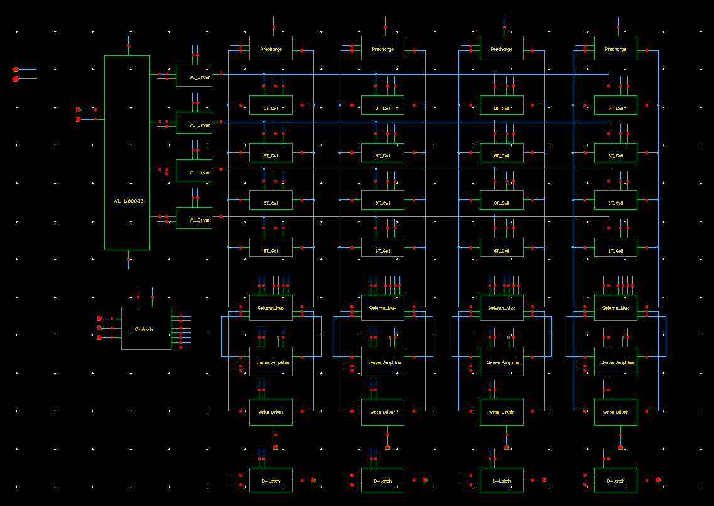
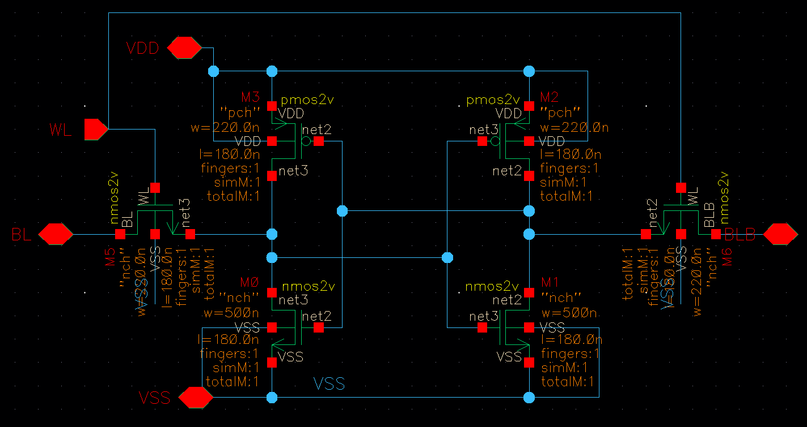
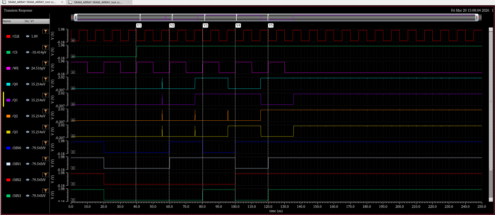
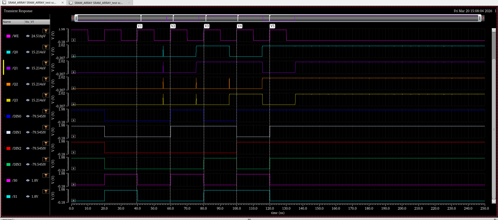
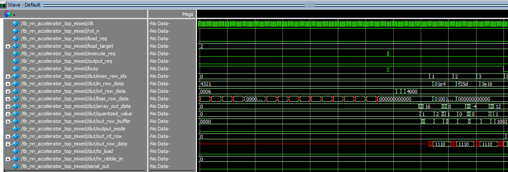
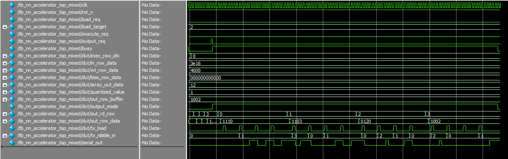
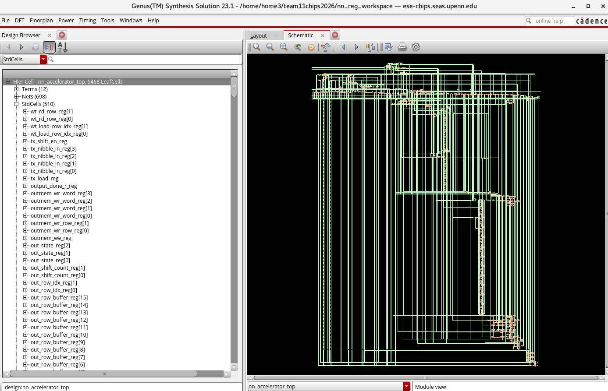
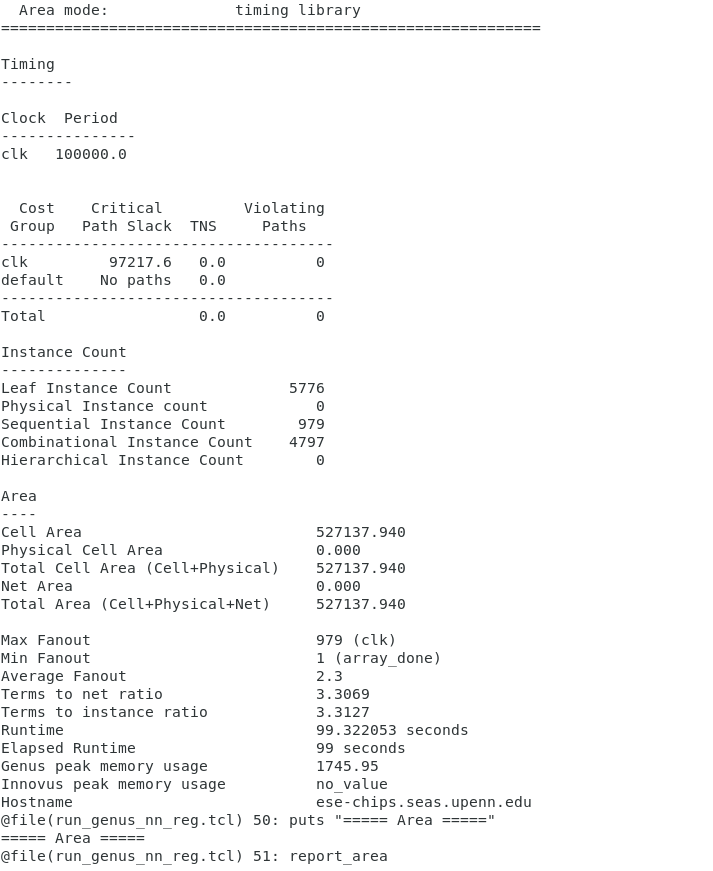
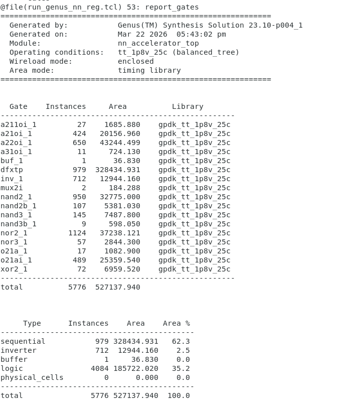
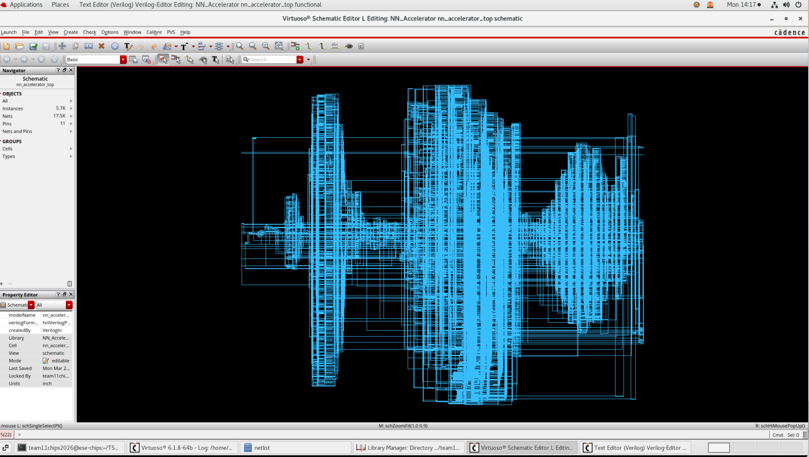

# Design Review 1

ESE 5730 Chip Design · Team 11: Kai Segimoto, Shang Wang · TA: Bryce Yu

> Markdown version of [`ESE5730 DR1.docx`](ESE5730%20DR1.docx) for reading on GitHub. The original Word file is in this repository.

## Design Status Clarification

At the current stage of Design Review 1:

- The design is **fully verified at the RTL level**

- A **complete synthesized top-level schematic** has been generated

- All modules are functionally integrated and tested end-to-end

However:

- **No physical layout has been completed yet**

- The design is currently implemented using a **digital flow (Genus + Innovus planned)**

- **SRAM macros are not yet finalized**, so:

  - register banks are used as functional substitutes

  - SRAM schematic and layout are being developed in parallel

This approach allows functional correctness to be validated before introducing memory-level complexity, and aligns with the planned project timeline for SRAM macro creation and physical design. Additionally, in the event that the liberate software is unable to characterize a multipath SRAM macro, the current design using registers can be used.

## Design Flow and Module Description

High level design flow: SPI → Load Controller → SRAM (register) Banks → systolic array → ReLU + Quant → Output (register) SRAM bank → Serializer → SPI OUT

A top level module **nn_accelerator_top** integrates the following modules and the correct connections/buffers between the system

**Global Control FSM (nn_control_fsm)**

The global control finite state machine coordinates the operation of the entire accelerator. It transitions between **LOAD**, **EXECUTE**, and **OUTPUT** modes based on external control signals. During each mode, it enables the appropriate modules (SPI loader, compute array, or serializer) while disabling others to prevent resource conflicts. The FSM also generates control signals such as memory write enable, execution triggers, and output read signals.

**SPI receiver (spi_nibble_slave)**

The SPI receiver serves as the frontend interface to the chip. It serially shifts in bits from the SPI MOSI line and groups every four bits into a single nibble. A valid signal is asserted whenever a complete nibble is received. This module allows external data (inputs, weights, and bias values) to be streamed into the accelerator in a compact serial format. This block operates using the SPI clock.

**Memory Loader (load_stream_controller)**

The load stream controller converts incoming nibbles into structured memory writes. Based on the selected load target (input, weight, or bias memory), it generates row and column addresses and asserts write enabled to the appropriate memory bank. For bias values, multiple nibbles are combined to form a wider word before writing. This module effectively bridges the serial SPI interface and the parallel memory architecture.

**Systolic Processing Elements (systolic_pe_ws)**

Each processing element performs a multiply-accumulate (MAC) operation. It stores a stationary weight value and receives streaming activations and partial sums. On each clock cycle, it multiplies the input activation with the stored weight and adds the result to the incoming partial sum. The updated partial sum is then passed downward, while activations propagate horizontally.

**Systolic Array (systolic_array_ws_4x4)**

The systolic array consists of a 4×4 grid of processing elements that compute matrix multiplication in a pipelined fashion. Weights are preloaded into the array, and activations are streamed across rows while partial sums propagate down columns. This structure enables high throughput by exploiting parallelism and data reuse, as described in the systolic array operation diagram.

**Activation + Quantization (relu_quant4)**

This module performs post-processing on the output of the systolic array. It first applies a ReLU activation function to remove negative values, then performs fixed-point quantization using rounding, right-shifting, and saturation to map results into a 4-bit range \[0,7\]. This step reduces data precision for efficient storage and computation in subsequent layers.

**Serializer (serial_nibble_tx)**

The serializer converts parallel 4-bit output values into a serial bitstream for transmission over SPI. During the OUTPUT phase, it reads data from the output memory and shifts it out bit-by-bit through the SPI interface. This enables compatibility with external microcontrollers or test systems.

**Memory Banks (Current Implementation) (sram_bank_4x4xN, sram_macro_4x1_word)**

The memory architecture uses modular 4x4 memory banks that implements one SRAM macro (figure 1) with 4 rows of 4 bits, which creates one word. N banks are connected in parallel depending on the size of the memory, so 4 banks are used for weight/activation memory and 12 banks are used for bias memory.

At the current stage of the project, register banks are used in place of SRAM macros for all memory blocks (input, weight, bias, and output memories). These register arrays replicate the functional behavior of SRAM, including row-based access and parallel readout, but are implemented using standard flip-flops for ease of simulation and verification.

This allows:

- rapid RTL verification and debugging

- simplified integration with the systolic array

- Simplified integration into the genus/innovus flow

## Design Methodology

The initial design targeted a 6×6 systolic array with 8-bit precision to maximize throughput. However, early analysis showed this would exceed area and resource constraints due to the large number of required registers. As a result, the design was scaled down to a 4×4 systolic array with 4-bit precision, significantly reducing area while preserving core functionality.

The control architecture was also simplified. Instead of generating all control signals and states internally, states are now generated as an external input into the FSM, reducing hardware complexity and improving integration.

The memory architecture was refined to use modular memory banks, constructed from smaller units for flexibility across inputs, weights, and biases. At this stage, register-based memory arrays are used in place of SRAM macros to enable faster RTL verification and simplify debugging.

Additionally, the design follows a fully synchronous approach, avoiding asynchronous elements to simplify timing and ensure compatibility with the digital flow.

Overall, the finalized design prioritizes area efficiency, modularity, and implementation feasibility, while maintaining the key functionality of a neural network accelerator.

## SRAM schematic

Figure 1: Top level SRAM schematic

Figure 2: SRAM Cell schematic and Sizing

Figure 3: SRAM Simulation output waveforms

The RTL describing the 4x1_word sram macro is written and tested to match the above SRAM I/Os and simulation. As seen in the images, S0 and S1 are cycled such that every row is written and read from, and the READ DOUT matches the WRITE DIN values, confirming SRAM operation is functional.

## RTL Simulation

Figure 4: NN_accelerator_top simulation 1

Figure 5: NN_accelerator_top simulation 2

To validate the correctness of the accelerator, a mixed-value test case was used instead of an extreme all-zero or all-seven pattern. The input matrix, weight matrix, and bias matrix were loaded through the SPI interface, and the top-level simulation was observed until the final output rows were read back from the output SRAM.

The input activation matrix A used in this test was:

A =

\[ 1, 2, 3, 4 \]

\[ 4, -2, 1, 0 \]

\[ -3, 5, 2, -1 \]

\[ 6, 1, -2, 3 \]

The weight matrix was:

W =

\[ 6, 0, 0, 0 \]

\[ 0, 5, 0, 0 \]

\[ 0, 0, 7, 0 \]

\[ 0, 0, 0, 4 \]

The bias matrix B was zero for rows 0, 2, and 3, while row 1 had a nonzero bias of +16 added to each output element:

B row 0 = \[ 0, 0, 0, 0 \]

B row 1 = \[16, 16, 16, 16\]

B row 2 = \[ 0, 0, 0, 0 \]

B row 3 = \[ 0, 0, 0, 0 \]

The accelerator computes:

C = ReLU((A × W + B) \>\> 4, with rounding and saturation to 0..7)

Because the weight matrix is diagonal-like, each output element is easy to verify. The raw matrix multiplication result A×W is:

A × W =

\[ 6, 10, 21, 16 \]

\[ 24, -10, 7, 0 \]

\[ -18, 25, 14, -4 \]

\[ 36, 5, -14, 12 \]

A × W + B =

\[ 6, 10, 21, 16 \]

\[ 40, 6, 23, 16 \]

\[ -18, 25, 14, -4 \]

\[ 36, 5, -14, 12 \]

Then ReLU removes negative values, and the quantizer applies a rounded right-shift by 4 bits. The final output matrix is therefore:

Output =

\[ 0, 1, 1, 1 \]

\[ 3, 0, 1, 1 \]

\[ 0, 2, 1, 0 \]

\[ 2, 0, 0, 1 \]

In the RTL waveform, these rows appear in packed hexadecimal row format as:

row0 = 1110

row1 = 1103

row2 = 0120

row3 = 1002

This exactly matches the expected result. For example, in row 3, the raw dot-product values are

\[36,5,−14,12\]. After ReLU and quantization, they become \[2,0,0,1\], which corresponds to the packed waveform value 1002. Similarly, row 1 includes the additional bias term, which changes the final row to 1103, confirming that bias addition is functioning correctly.

Therefore, the top-level simulation verifies that the accelerator correctly performs matrix multiplication, bias addition, ReLU activation, quantization, row buffering, SRAM writeback, and final output readout.

## Genus Synthesized top level schematic

Figure 6: Genus GUI synthesized schematic

Figure 7: Timing/instance count/area summary Figure 8: Area/Gate report

As seen in figure 6: the top level schematic is synthesized using Cadence Genus, and the schematic is displayed through the Genus GUI. Additionally, figures 7 and 8 display the timing, instance/gate count, and area reports. Our synthesized RTL uses **5776 instances**, which will take an **estimated area = 527138 mm2**, which is within the provided 1um2 size.

Next, the output.v netlist is imported into cadence virtuoso and schematic is synthesized for further analysis.

Figure 9: Cadence Virtuoso Synthesized schematic

Provide clear and detailed task explanation performed by each group member.

\- Provide task assignment for each group member moving forward. Also reflect the

task assignments in your project timeline.

\- Write one page on updated measurement plan. How would you characterize the

functionality and performance of your chip? How would you use your chip in a

practical application? Are there any changes from the proposal you submitted?

VII\. Task Explanation Performed by Each Group Member

Shang was mainly responsible for the Verilog RTL development, top-level integration, and functional simulation of the accelerator. This included connecting the major modules, debugging the control and data flow, building the simulation environment, and verifying the correctness of the matrix computation and output behavior in ModelSim. Kai was mainly responsible for the SRAM design and testing, including the SRAM macro implementation and verification of its read/write behavior. The Genus synthesis work was completed jointly by both team members, including preparing the synthesis scripts, constraints, and debugging synthesis-related issues during the RTL-to-Cadence flow.

VIII\. Updated Task Assignment and Project Timeline

| **Task**                                                           | **Start Date** | **End Date** | **Assigned To** | **Description**                                                                                                                 |
|----------------------------------------------------------------------------------------------|------------------------------------------|----------------------------------------|-------------------------------------------|-----------------------------------------------------------------------------------------------------------------------------------------------------------|
| Verilog Coding and Simulation for Top-Level Integration            | 3/10           | 3/16         | Shang           | Complete RTL integration of all major modules and verify functionality with simulation.                                         |
| SRAM Macro Design, Schematic, and Testing                          | 3/12           | 3/25         | Kai             | Design the SRAM macro, verify SRAM functionality, and prepare the memory block for system integration.                          |
| Standard Cell Library Characterization in Cadence                  | 3/17           | 3/25         | Shang           | Build and characterize the standard cell library and generate the .lib models required for synthesis.                           |
| Synthesize Verilog and Port to Cadence                             | 3/26           | 4/3          | Shang and Kai   | Run Genus synthesis, debug synthesis issues, and prepare the gate-level design and required files for the Cadence digital flow. |
| Run and Verify Innovus Flow, Import DEF into Virtuoso, Fix DRC/LVS | 4/4            | 4/12         | Shang and Kai   | Complete place-and-route, import the generated layout data, and resolve DRC/LVS/timing issues.                                  |
| Final Confirmation and Tapeout Preparation                         | 4/13           | 4/20         | Shang and Kai   | Perform final verification, complete signoff checks, and prepare the final deliverables for tapeout.                            |

VIIII\. Updated Measurement Plan, Practical Application, and Changes from the Original Proposal

Our updated measurement plan focuses on verifying both the functionality and the practical performance of the chip after fabrication. The chip is intended to execute matrix-based neural-network-style computation using local SRAM storage, low-bitwidth arithmetic, quantization, and serialized output. Therefore, the primary goal of measurement is to confirm that the chip can correctly complete the full operation flow: loading the input, weight, and bias data, performing matrix multiplication and accumulation, applying bias and ReLU/quantization, storing the result, and finally outputting the result. To test this on hardware, we plan to place the chip on a PCB and use an external Arduino to provide the FSM control inputs. The Arduino will drive the chip through its operating states, including load, execute, and output, so that the complete top-level behavior can be reproduced on the test platform.

To display the computation results, we plan to connect seven-segment displays on the PCB. Since the chip outputs its results in serialized form, the seven-segment displays will provide a convenient way to observe the output data in a human-readable manner. During testing, the Arduino will control the FSM sequence, the chip will compute the matrix result, and the final output will be shown on the display. We will compare the displayed results against the expected values from RTL simulation in order to validate correctness. Multiple test cases will be used, including mixed signed-value input patterns, so that we can verify not only basic operation but also correct handling of signed arithmetic, bias addition, ReLU behavior, and quantization.

In addition to functional verification, we also plan to characterize several performance-related aspects of the chip. One important metric is latency, measured from the assertion of the execute command to the availability of valid output data. Another metric is output throughput, which can be evaluated by measuring how quickly rows or serialized output values are produced once the computation begins. If lab equipment is available, we also plan to monitor the serial output waveform using a logic analyzer or oscilloscope to verify correct bit ordering and timing behavior. If possible, we will also observe the chip under different operating frequencies to check timing robustness and functional stability. These measurements will provide a useful picture of how the chip behaves not only functionally but also as a practical digital hardware system.

From an application perspective, this design is relevant to a broad range of hardware systems that require matrix operations. AI accelerators, low-power inference engines, embedded signal-processing systems, and edge-computing devices all rely heavily on matrix multiplication and accumulation. Our chip demonstrates a simplified but representative computation pipeline for these kinds of applications, including local storage, fixed-function arithmetic, quantization, and serial output. As a result, although the design is educational in scale, the underlying architecture is broadly applicable to many AI and matrix-computation use cases.

Compared with the original proposal, the main design change is that the arithmetic precision was reduced from 6 bits to 4 bits. This change was made primarily to reduce area and simplify implementation. By reducing the datapath and storage width, the design became more area-efficient and more feasible for integration within the project constraints. Although this reduces the numerical precision compared with the original plan, it does not change the overall architecture or the core project objective. The chip still demonstrates the intended accelerator workflow, including matrix multiplication, memory access, nonlinear processing, and output serialization. Therefore, the updated 4-bit implementation should be viewed as a practical refinement of the original proposal rather than a change in project direction.
