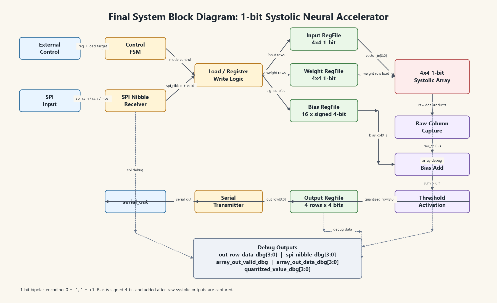
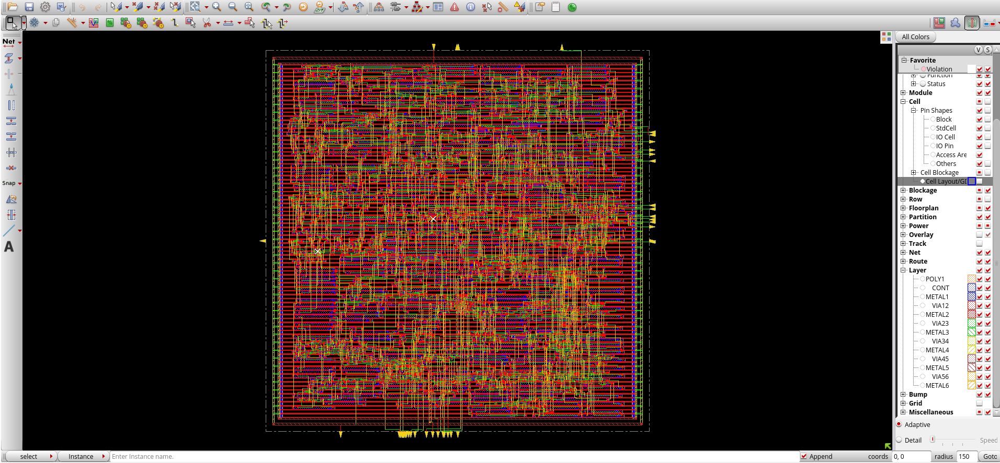
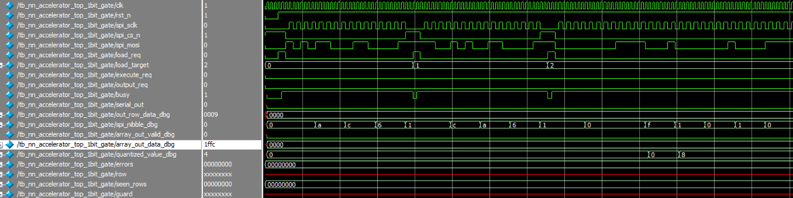
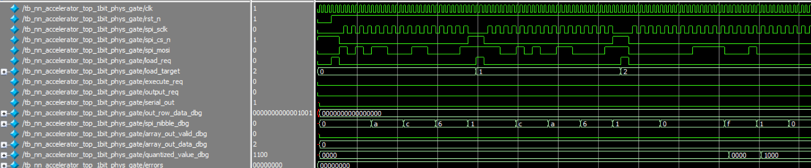
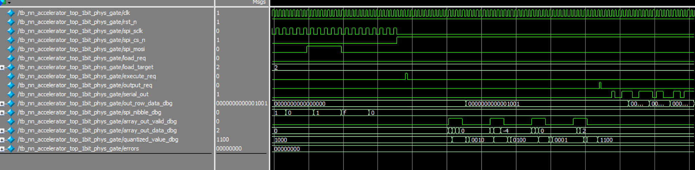

# Design Review 2

ESE 5730 Chip Design · Team 11: Kai Segimoto, Shang Wang · TA: Bryce Yu

> Markdown version of [`Team11_Design_Review2.docx`](Team11_Design_Review2.docx) for reading on GitHub. The original Word file is in this repository.

## Layout Step

To finalize the layout of our design, we first completed logic synthesis to generate a gate-level netlist and timing constraints, and then imported the synthesized Verilog netlist into Cadence Innovus together with the matching technology and library files. In the design import stage, we loaded the standard-cell LEF file so Innovus could recognize the physical dimensions and pin locations of the cells, and we set up the MMMC analysis configuration by defining the library set, delay corner, constraint mode, and analysis view using the timing library and SDC file. After the design was imported successfully, we specified the floorplan by defining the core dimensions and the core-to-IO boundary spacing so that the tool had a valid placement region for the cells.

After setup, we ran standard-cell placement, which arranged the synthesized cells inside the core area and performed trial routing to estimate routing feasibility and congestion. Once placement completed, we checked the resulting utilization and verified that the core size was reasonable. We then ran SRoute to generate power rails and checked pre-CTS timing. Next, pre-CTS optimization is run to fix initial logic timing so CTS is easier, and prevent hold violations. Buffers on the outputs are placed to drive outputs. Then CTS is run to build the physical network that distributes the clock to flipflops. Then post-CTS optimization is run to fix timing with clock skew before running NanoRoute with the default routing settings to generate the final interconnections between cells. Finally, post routing optimization is run to account for issues with wires such as RC delays. After routing, we examined the physical view and reviewed the routing statistics and any DRC information reported by Innovus. The final timing report is viewed to make sure there are no setup or hold timing violations. Finally, to complete the layout flow, we saved the routed design and exported the .def and .v netlist, as well as a GDSII format using the required map file so that the final layout could be viewed and used in later stages.

## System Block diagram

## Difference from review 1

Compared with the design presented in Design Review 1, the Design Review 2 version was modified mainly to reduce area and improve implementation feasibility. The original design used higher-bit-width activation and weight data and included SRAM-based storage. In the updated design, we reduced the activation and weight precision to 1 bit and used bipolar encoding, where 0 represents -1 and 1 represents +1. This allowed the processing elements in the systolic array to be simplified significantly, since the multiplication operation can be implemented using simple bit comparison/XOR-style logic instead of a wider multiplier. We also removed the SRAM-based storage and replaced it with register-based storage generated by Genus, which simplified the integration flow and made the design easier to synthesize and place-and-route within the available area budget. The bias values are still kept as signed 4-bit values so that the design can retain a useful threshold-shifting capability after the raw systolic array output.

In addition to reducing the datapath width, we added several debug outputs to make the fabricated design easier to verify. These debug wires expose important internal signals such as the received SPI nibble, the raw systolic array output, the array valid signal, the quantized output value, and the final output row data. These signals do not change the main computation, but they improve observability during simulation and hardware testing. Because debug wires can increase routing and pad usage, we later simplified the debug buses so that only meaningful low-bit signals are exposed, avoiding unnecessary constant or sign-extension bits that could appear as floating or tied signals in the physical design.

After parasitic extraction and back-end investigation, the main modification was not to the core algorithm itself, but to the implementation structure and debug interface. We reduced the bit width and simplified the storage architecture to address area constraints, and we cleaned up the debug outputs to avoid unnecessary routing overhead. The final design therefore preserves the core neural-network computation flow of weighted accumulation, bias addition, and threshold activation, while using a more compact 1-bit systolic architecture suitable for the available chip area.

## Detailed schematic and layout

Final optimized Layout without pad connections

## RTL simulation

## Original RTL code simulation

NN_accelerator_top simulation 1

NN_accelerator_top simulation 2

1.  RTL simulation of the generated netlist of genus

Post Genus Synthesis Netlist verification

The Genus-generated gate-level netlist was verified using ModelSim with the same 1-bit accelerator test case used for RTL verification. During the simulation, the SPI input sequence was applied to load the input activations, weights, and signed 4-bit bias values into the design. After the execute_req signal was asserted, the synthesized circuit produced the expected internal computation behavior, including valid raw systolic-array outputs and the corresponding thresholded 1-bit results. The final output rows observed through the debug output matched the expected values: 1001, 0011, 0110, and 1101.

This confirms that the gate-level netlist generated by Genus preserves the intended RTL functionality. The testbench completed with no functional errors, and the observed output rows matched the expected binary neural-network computation results. Therefore, the synthesized circuit is functionally consistent with the RTL design for this verification case.

2.  Gate-Level Functional Simulation of the Innovus-Generated Netlist

Post Innovus Place and Route Netlist verification

The generated gate-level netlist was verified using ModelSim to confirm that the synthesized and physically exported circuit preserves the intended RTL functionality. Because the Innovus-exported netlist included physical power pins and physical-only cells, a gate-level testbench was used to connect VDD and VSS and provide functional models for the standard cells. The same 1-bit neural accelerator test case was then applied through the SPI input interface.

During simulation, the input activation bits, weight bits, and 4-bit signed bias values were loaded through spi_mosi, spi_sclk, and spi_cs_n. After loading, execute_req triggered the 1-bit systolic array computation. The debug signals show the intermediate behavior of the circuit: spi_nibble_dbg confirms correct SPI data capture, array_out_data_dbg shows the raw systolic-array dot-product output, array_out_valid_dbg marks valid array outputs, and quantized_value_dbg shows the thresholded 1-bit result after bias addition. The final output rows observed through out_row_data_dbg were 1001, 0011, 0110, and 1101, which match the expected output matrix from the RTL simulation.

This confirms that the generated gate-level netlist is functionally consistent with the intended 1-bit accelerator design for this test case.

1.  Updated Task Assignment and Project Timeline

| **Task**                            | **Start Date** | **End Date** | **Assigned To** | **Description**                                                                                 |
|---------------------------------------------------------------|------------------------------------------|----------------------------------------|-------------------------------------------|---------------------------------------------------------------------------------------------------------------------------|
| DRC/LVS Clean (Block Level)         | 4/6            | 4/12         | Shang & Kai     | Ensure each block layout is DRC/LVS clean and fix all physical verification issues.             |
| DRC/LVS Clean (Full Chip + ESD)     | 4/12           | 4/16         | Kai & Shang     | Verify full-chip layout including ESD diodes, ensuring complete DRC/LVS clean results.          |
| Final Verification and Tapeout Prep | 4/17           | 4/20         | Shang & Kai     | Perform final signoff checks (DRC/LVS/timing), validate design, and prepare final deliverables. |

2.  Task Explanation Performed by Each Group Member

Kai was mainly responsible for generating the synthesized circuit using Genus and producing the physical layout using Innovus. This included setting up the synthesis flow, generating the gate-level implementation, running the Innovus place-and-route flow, and preparing the layout for later verification.

Shang was mainly responsible for RTL optimization and functional verification. This included modifying the accelerator architecture to reduce area, updating the 1-bit systolic computation flow, adding and refining debug signals, and running simulations to verify both the RTL behavior and the Genus-generated gate-level netlist.

Both team members worked together on layout optimization, including reviewing area constraints, checking debug signal routing impact, and making design-level adjustments to improve the feasibility of the final physical implementation.
